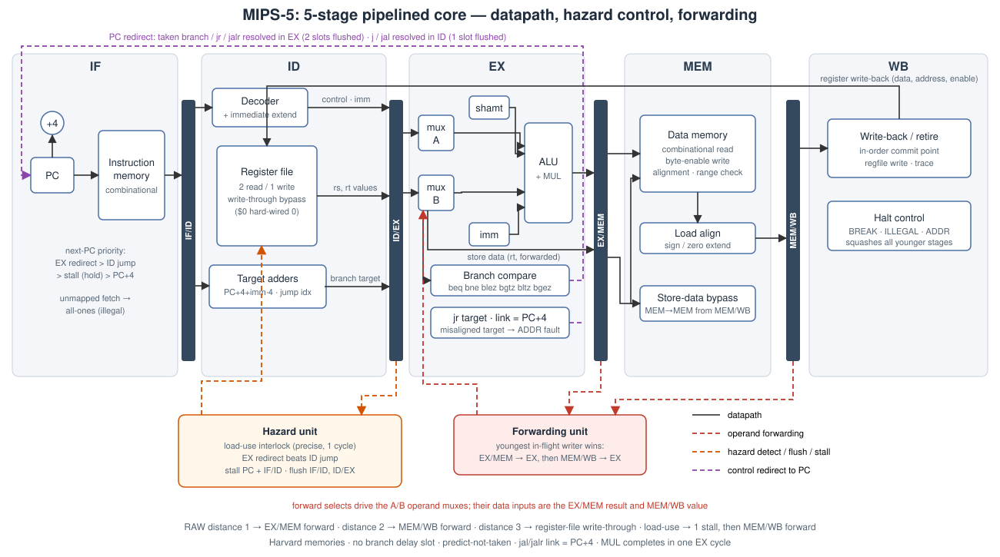

# MIPS-5 — a 5-stage pipelined 32-bit MIPS core, verified to death

A complete, rigorously verified **5-stage pipelined (IF/ID/EX/MEM/WB) 32-bit MIPS processor core** in synthesizable
Verilog-2005, with full hazard handling (operand forwarding, load-use interlock, branch/jump flush control), a
single-cycle baseline built from the same modules, a software golden model, 41 directed programs, a constrained-random
generator, bounded-exhaustive hazard sequences, SystemVerilog assertions and functional coverage, mutation testing of
the verification itself, and a 16-workload benchmark study of pipeline efficiency and stall behaviour.



## Headline results

| | |
|---|---|
| ISA | 44 instructions (MIPS32 integer subset incl. `mul`, byte/half loads & stores, all branches, `j/jal/jr/jalr`) |
| Pipeline | IF · ID · EX · MEM · WB; forwarding EX/MEM→EX and MEM/WB→EX, regfile write-through, MEM→MEM store-data forwarding, 1-cycle precise load-use interlock |
| Control hazards | predict-not-taken, **no delay slot**; branch/`jr`/`jalr` resolved in EX (2-slot flush), `j/jal` in ID (1-slot flush) |
| Precise halting | `break` / illegal instruction / address error; nothing younger than the halting instruction ever commits |
| Directed tests | **41** self-checking programs (≈ 1,070 in-program `check` statements incl. a 100-cell hazard matrix and an 88-cell branch matrix) |
| Random | @@RANDOM@@ |
| Bounded-exhaustive | @@EXHAUSTIVE@@ |
| Assertions / coverage | 20 SystemVerilog assertion groups (@@ASSERTS@@ evaluations in the full regression) · @@BINS@@ functional-coverage bins, **0 holes** |
| Cross-checks | every run: byte-exact retirement trace + final state vs. ISS on **3 RTL variants**; hardware cycle counters = analytical model = issue-time recurrence |
| Mutation testing | **@@MUT@@** injected RTL bugs killed (`docs/MUTATION.md`) |
| Benchmarks | 16 workloads, @@BENCHINSTR@@ retired instructions: aggregate **CPI @@CPI@@**, geometric-mean **@@SPEEDUP@@× speed-up** over the single-cycle core (analytical clock model) |

## Quick start

Requirements: Icarus Verilog ≥ 12, Python ≥ 3.9 (+ `matplotlib` for the benchmark charts).

```bash
git clone git@github.com:ShubhamX90/mips5_pipeline.git && cd mips5_pipeline
make            # lint · build 3 simulators · tool unit tests · directed + 200 random · benchmarks
make test       # tool tests + the 41 directed programs
make random RANDOM_SEEDS=1000
make exhaustive # 14^4 x 2 hazard-sequence blocks (~800k instructions) on every RTL variant
make mutation   # inject 71 RTL bugs and prove the regression catches them (~10 min)
make bench      # regenerate docs/BENCHMARKS.md and charts
make pipeview T=tests/asm/24_back_to_back_control.s     # stage-occupancy diagram from the RTL
make wave T=tests/asm/24_back_to_back_control.s         # VCD for GTKWave
```

Write your own program and run it through the entire flow:

```bash
python3 tools/regress.py one my_program.s      # assemble → ISS → 3 RTL variants → compare everything
```

## What's in the box

```text
rtl/        Verilog-2005 RTL (pipeline stages, hazard & forwarding units, single-cycle core, memories)
tb/         SystemVerilog testbench, assertions (mips_assertions.sv), coverage (mips_coverage.sv)
tools/      isa.py asm.py iss.py (golden model) perfmodel.py randgen.py regress.py exhaustive.py
            mutation.py bench.py golden.py pipeview.py
tests/asm/  41 directed programs       tests/gen/  generators for the matrix tests
tests/test_tools.py                    unit tests of the tool-chain against MIPS32 reference encodings
bench/      16 benchmark programs      docs/       ISA, architecture, hazards, verification, benchmarks, mutation report
```

| document | contents |
|---|---|
| [`docs/ARCHITECTURE.md`](docs/ARCHITECTURE.md) | module hierarchy, stage-by-stage description, pipeline registers, interfaces, a real pipeline diagram |
| [`docs/ISA.md`](docs/ISA.md) | instruction set, deliberate deviations from MIPS32, memory map, halt model, trace formats, assembler |
| [`docs/HAZARDS.md`](docs/HAZARDS.md) | every hazard class, forwarding/stall rules, correctness arguments, the cycle-accounting identity |
| [`docs/VERIFICATION.md`](docs/VERIFICATION.md) | the five verification layers, test catalogue, assertion list, coverage, limitations |
| [`docs/BENCHMARKS.md`](docs/BENCHMARKS.md) | single-cycle vs. pipeline study: CPI stacks, stall sources, speed-up model, design what-ifs |
| [`docs/MUTATION.md`](docs/MUTATION.md) | the 71 injected bugs and how each was caught |

## Design decisions worth knowing

* **No branch delay slot.** Branch flush control is a first-class mechanism; `jal` links `PC+4`.
* **Branches resolve in EX, jumps in ID.** Simple forwarding network (no extra operand paths for control flow), 2-cycle taken-branch
  penalty — and the ISS-derived what-if study shows what a static predictor or ID-stage resolution would buy
  (`docs/BENCHMARKS.md`).
* **Bubbles are inert by construction** (`valid=0` *and* all controls zero), so flushing only needs to clear `valid` and wrong-path
  stores, `break`s, illegal opcodes and faulting accesses can never leak.
* **Precise halting.** The in-order WB stage commits state and takes the halt; `stop` squashes every younger stage, including the
  store that is in MEM on that very cycle.
* **Both cores speak the same retirement protocol**, so one testbench, one golden model and one regression validate the pipeline *and*
  its baseline.
* **Verification is itself verified**: assertions restate the pipeline contract independently of the implementation, and mutation
  testing proves the whole environment kills realistic bugs (it found a real hole: an imprecise interlock — fixed by
  `40_decode_precision`).

## Honest limitations

Simulation-based only (no formal proof, no synthesis — the clock-period numbers are an *analytical* model, clearly labelled);
`mul` is a single-cycle EX operation; memories are behavioural with combinational read; verified with a single simulator
(Icarus Verilog 12). See `docs/VERIFICATION.md §9`.
