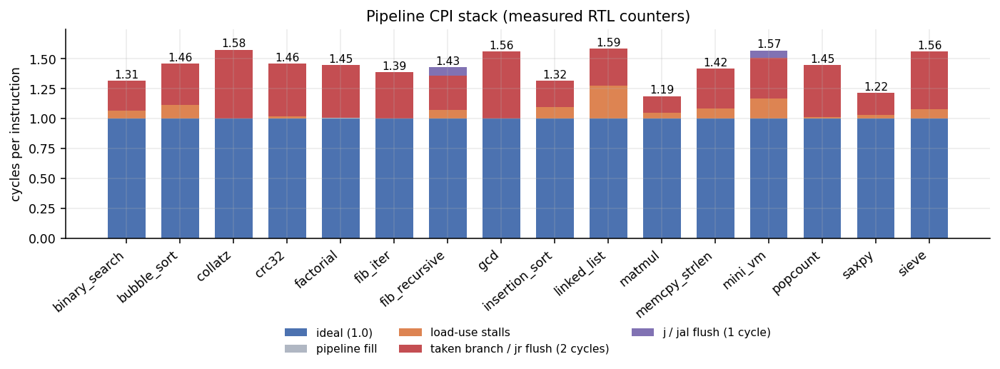
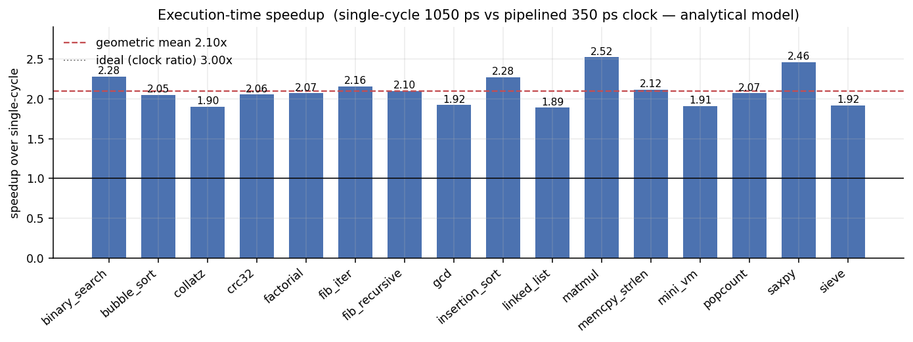
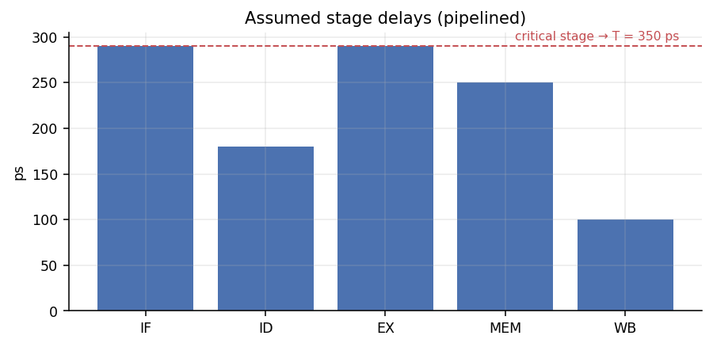
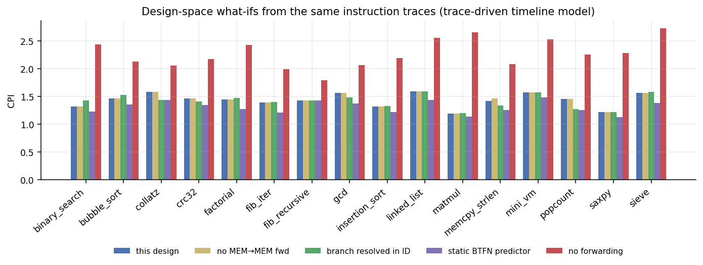
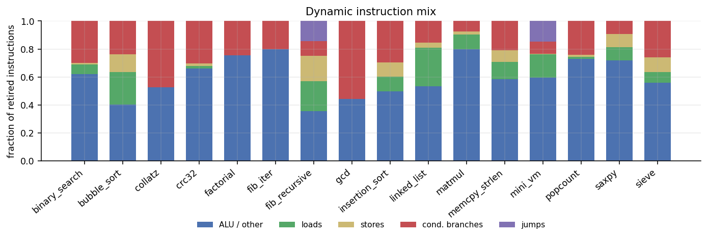

# Benchmarks: single-cycle vs. 5-stage pipeline

_Generated by `tools/bench.py` — do not edit by hand. Re-run with `make bench`._

Everything in the **cycle** columns is measured on the RTL (hardware counters), after the full equivalence flow (retirement trace + final state against the ISS, SVA assertions, cycle model) passed for all three RTL variants and `$v0` matched an independent native-Python result. The **time** columns apply an *analytical* clock model (below); they are not synthesis results.

## Summary

* 16 workloads, 358,204 retired instructions, 526,431 pipeline cycles (aggregate CPI **1.470**).
* Lowest CPI: `matmul` (1.189); highest: `linked_list` (1.586).
* In cycles alone the pipeline is *slower* than the single-cycle core by 1.43x (geomean) — that is the price of hazards; it buys a 3.00x shorter clock.
* Net execution-time speedup under the clock model: **2.10x geometric mean** (range 1.89x – 2.52x).

## Per-benchmark results

| benchmark | instr | cycles (single) | cycles (pipe) | CPI | load-use stalls | EX flush cycles | ID flush cycles | cond. branches (taken) | speedup (time) |
|---|---:|---:|---:|---:|---:|---:|---:|---:|---:|
| `binary_search` | 23,497 | 23,497 | 30,891 | 1.315 | 1,608 | 5,782 | 0 | 7,019 (41%) | 2.28x |
| `bubble_sort` | 17,681 | 17,681 | 25,863 | 1.463 | 2,016 | 6,162 | 0 | 4,223 (73%) | 2.05x |
| `collatz` | 78,993 | 78,993 | 124,515 | 1.576 | 0 | 45,518 | 0 | 37,543 (61%) | 1.90x |
| `crc32` | 7,558 | 7,558 | 11,030 | 1.459 | 128 | 3,340 | 0 | 2,304 (72%) | 2.06x |
| `factorial` | 944 | 944 | 1,366 | 1.447 | 0 | 418 | 0 | 230 (91%) | 2.07x |
| `fib_iter` | 20,503 | 20,503 | 28,505 | 1.390 | 0 | 7,998 | 0 | 4,100 (98%) | 2.16x |
| `fib_recursive` | 72,340 | 72,340 | 103,345 | 1.429 | 5,166 | 20,668 | 5,167 | 7,751 (67%) | 2.10x |
| `gcd` | 6,033 | 6,033 | 9,421 | 1.562 | 0 | 3,384 | 0 | 3,359 (50%) | 1.92x |
| `insertion_sort` | 11,897 | 11,897 | 15,687 | 1.319 | 1,136 | 2,650 | 0 | 3,538 (37%) | 2.28x |
| `linked_list` | 7,431 | 7,431 | 11,783 | 1.586 | 2,048 | 2,300 | 0 | 1,152 (100%) | 1.89x |
| `matmul` | 10,161 | 10,161 | 12,079 | 1.189 | 512 | 1,402 | 0 | 776 (90%) | 2.52x |
| `memcpy_strlen` | 9,630 | 9,630 | 13,636 | 1.416 | 802 | 3,200 | 0 | 2,003 (80%) | 2.12x |
| `mini_vm` | 49,421 | 49,421 | 77,613 | 1.570 | 8,192 | 16,892 | 3,104 | 4,352 (100%) | 1.91x |
| `popcount` | 20,096 | 20,096 | 29,114 | 1.449 | 256 | 8,758 | 0 | 4,893 (89%) | 2.07x |
| `saxpy` | 8,210 | 8,210 | 10,000 | 1.218 | 256 | 1,530 | 0 | 768 (100%) | 2.46x |
| `sieve` | 13,809 | 13,809 | 21,583 | 1.563 | 1,052 | 6,718 | 0 | 3,584 (94%) | 1.92x |



The CPI stack is exact: `cycles = instret + 4 (fill) + load-use stalls + 2·(taken branch/jr) + 1·(j/jal)`, an identity the regression asserts for every program.

## Where do the stalls come from?

| benchmark | dominant loss | loss CPI | comment |
|---|---|---:|---|
| `binary_search` | branch/jr flush | 0.246 | load→compare→three-way branch per probe. |
| `bubble_sort` | branch/jr flush | 0.349 | data-dependent swap branch and the load→compare→branch chain. |
| `collatz` | branch/jr flush | 0.576 | parity branch (taken on even) plus the unconditional back-edge `b`: exactly 4 flush cycles per Collatz step. |
| `crc32` | branch/jr flush | 0.442 | 1024 data-dependent bit branches, half taken. |
| `factorial` | branch/jr flush | 0.443 | MUL→MUL forwarding is free; loop back-edges only. |
| `fib_iter` | branch/jr flush | 0.390 | single dependent ALU chain (fully forwarded) + one taken back-edge per 5 instructions. |
| `fib_recursive` | branch/jr flush | 0.286 | call/return: reloaded arguments/results feed the next instruction (`lw $a0→addiu`, `lw $t1→addu`), plus `jal` (1-cycle) and `jr` + taken-branch (2-cycle) redirects. |
| `gcd` | branch/jr flush | 0.561 | subtract loop: direction of the compare flips unpredictably; every taken edge is a 2-cycle flush. |
| `insertion_sort` | branch/jr flush | 0.223 | inner-loop exit branch and the unconditional back-edge. |
| `linked_list` | branch/jr flush | 0.310 | pointer chasing: two load-use bubbles per hop (`lw` pointer → `lw` value address, then value → `addu`). |
| `matmul` | branch/jr flush | 0.138 | load-use into MUL inside the k-loop; branch loss small (8-iteration loops). |
| `memcpy_strlen` | branch/jr flush | 0.332 | `lbu → beq` load-use per byte plus taken back-edges. |
| `mini_vm` | branch/jr flush | 0.342 | the dispatch chain `lbu→sll`, `lw→jr` costs two load-use bubbles, a 2-cycle `jr` flush and a 1-cycle `j next` flush per bytecode. |
| `popcount` | branch/jr flush | 0.436 | 4-instruction dependent loop (`addiu/and/addiu/bne`) with a taken back-edge every iteration. |
| `saxpy` | branch/jr flush | 0.186 | only load-use into MUL/add; one well-behaved loop branch. |
| `sieve` | branch/jr flush | 0.486 | short inner loops, byte stores; back-edge flushes dominate. |

## Execution-time model (analytical)

Stage delay assumptions (ps): IF 290, ID 180, EX 290, MEM 250, WB 100; register overhead 60.

* **Pipelined clock** = overhead + slowest stage = 60 + 290 = **350 ps** (EX: forwarding mux + ALU).
* **Single-cycle clock** = overhead + IMEM + RF read + ALU + DMEM + RF write + PC mux = **1050 ps**.
* Ideal pipelining gain = 3.00x; realised = ideal / CPI. Change the assumptions with `python3 tools/bench.py --imem 300 --alu 400 ...`.





Sensitivity of the geometric-mean speedup to the pipelined clock period:

| pipelined T (ps) | 250 | 300 | 350 | 400 | 450 | 500 |
|---|---:|---:|---:|---:|---:|---:|
| geomean speedup | 2.94x | 2.45x | 2.10x | 1.84x | 1.63x | 1.47x |

## Design-space what-ifs

The ISS retirement trace fully determines the instruction stream, so alternative hazard policies can be evaluated with a trace-driven timeline model (`tools/perfmodel.py`). The model is *validated* by reproducing the RTL's exact cycle count for the baseline on every test program in the regression; the alternatives are model predictions, not RTL.



| benchmark | CPI this design | no MEM→MEM fwd (RTL) | branch in ID | static BTFN | no forwarding |
|---|---:|---:|---:|---:|---:|
| `binary_search` | 1.315 | 1.315 | 1.423 | 1.228 | 2.434 |
| `bubble_sort` | 1.463 | 1.463 | 1.527 | 1.349 | 2.127 |
| `collatz` | 1.576 | 1.576 | 1.435 | 1.432 | 2.056 |
| `crc32` | 1.459 | 1.459 | 1.408 | 1.342 | 2.172 |
| `factorial` | 1.447 | 1.447 | 1.469 | 1.270 | 2.422 |
| `fib_iter` | 1.390 | 1.390 | 1.395 | 1.205 | 1.990 |
| `fib_recursive` | 1.429 | 1.429 | 1.429 | 1.429 | 1.786 |
| `gcd` | 1.562 | 1.562 | 1.476 | 1.374 | 2.057 |
| `insertion_sort` | 1.319 | 1.319 | 1.324 | 1.213 | 2.191 |
| `linked_list` | 1.586 | 1.586 | 1.586 | 1.431 | 2.551 |
| `matmul` | 1.189 | 1.189 | 1.196 | 1.135 | 2.654 |
| `memcpy_strlen` | 1.416 | 1.458 | 1.333 | 1.251 | 2.082 |
| `mini_vm` | 1.570 | 1.570 | 1.570 | 1.483 | 2.523 |
| `popcount` | 1.449 | 1.449 | 1.269 | 1.257 | 2.256 |
| `saxpy` | 1.218 | 1.218 | 1.218 | 1.126 | 2.280 |
| `sieve` | 1.563 | 1.563 | 1.577 | 1.384 | 2.727 |
| **aggregate** | **1.470** | **1.471** | **1.435** | **1.365** | **2.168** |

Take-aways: forwarding is worth 48% in cycles; MEM→MEM store-data forwarding is worth 0.1%; a static backward-taken predictor would save 7.1% of cycles; resolving branches in ID (with the extra operand-forwarding hardware that implies) 2.3%.

## Instruction mix



| benchmark | ALU/other | loads | stores | branches | jumps | fwd EX/MEM+MEM/WB per instr |
|---|---:|---:|---:|---:|---:|---:|
| `binary_search` | 62.2% | 6.8% | 1.1% | 29.9% | 0.0% | 0.60 |
| `bubble_sort` | 40.4% | 23.2% | 12.5% | 23.9% | 0.0% | 0.40 |
| `collatz` | 52.5% | 0.0% | 0.0% | 47.5% | 0.0% | 0.24 |
| `crc32` | 66.1% | 1.7% | 1.7% | 30.5% | 0.0% | 0.52 |
| `factorial` | 75.6% | 0.0% | 0.0% | 24.4% | 0.0% | 0.53 |
| `fib_iter` | 80.0% | 0.0% | 0.0% | 20.0% | 0.0% | 0.40 |
| `fib_recursive` | 35.7% | 21.4% | 17.9% | 10.7% | 14.3% | 0.29 |
| `gcd` | 44.3% | 0.0% | 0.0% | 55.7% | 0.0% | 0.25 |
| `insertion_sort` | 49.6% | 10.6% | 10.1% | 29.7% | 0.0% | 0.49 |
| `linked_list` | 53.5% | 27.6% | 3.4% | 15.5% | 0.0% | 0.65 |
| `matmul` | 79.8% | 10.7% | 1.9% | 7.6% | 0.0% | 0.76 |
| `memcpy_strlen` | 58.4% | 12.5% | 8.3% | 20.8% | 0.0% | 0.46 |
| `mini_vm` | 59.5% | 16.6% | 0.5% | 8.8% | 14.6% | 0.60 |
| `popcount` | 73.1% | 1.3% | 1.3% | 24.3% | 0.0% | 0.51 |
| `saxpy` | 71.9% | 9.4% | 9.4% | 9.4% | 0.0% | 0.66 |
| `sieve` | 55.9% | 7.6% | 10.5% | 26.0% | 0.0% | 0.62 |

## Reproduce

```bash
make bench
```
